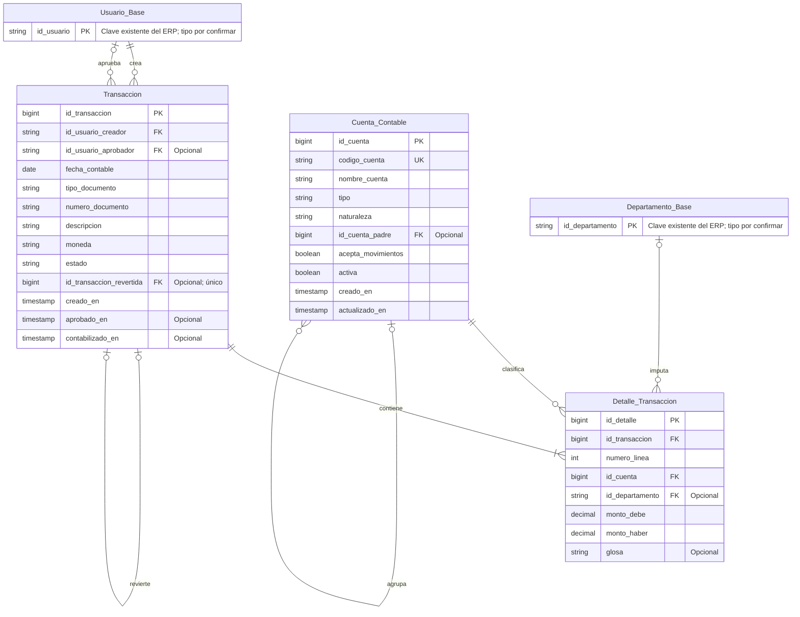

# Modelo de Datos — Módulo de Contabilidad y Finanzas

## Propósito y límites

Este modelo define las tablas que pertenecen al módulo financiero y muestra sus referencias a datos maestros del ERP. `Usuario_Base` y `Departamento_Base` son dependencias compartidas: el módulo las consulta y referencia por sus claves, pero **no las crea, duplica ni administra**. Los nombres y tipos concretos de esas claves deben alinearse con el contrato del ERP anfitrión antes de implementar las restricciones SQL.

El modelo de datos publicado para el módulo base del repositorio especifica `Entity` y `Document`, pero no define las tablas `Usuario_Base` ni `Departamento_Base`. Por tanto, las claves de integración de abajo son un contrato conceptual pendiente de confirmar con el ERP anfitrión, no una afirmación de que ya están implementadas en este repositorio. El MVP financiero no requiere modificar `Entity` ni `Document`; una futura conciliación con facturas u otros documentos deberá añadir una relación explícita y acordada.

## Diagrama Entidad-Relación

## Entidades del módulo

### Cuenta_Contable

Catálogo de cuentas de la empresa. `codigo_cuenta` identifica de forma única una cuenta dentro de la instancia financiera. `tipo` clasifica la cuenta como Activo, Pasivo, Patrimonio, Ingreso o Egreso; `naturaleza` identifica su saldo normal (Debe o Haber). `id_cuenta_padre` permite construir jerarquías. Solo las cuentas activas que aceptan movimientos pueden usarse en detalles; las cuentas padre normalmente no aceptan imputaciones.

### Transaccion

Encabezado de un asiento contable. Guarda la fecha contable, el origen documental declarado, su descripción, moneda, estado y trazabilidad. `id_usuario_creador` y `id_usuario_aprobador` apuntan al usuario compartido del ERP. El aprobador y sus marcas de tiempo son nulos mientras no se apruebe o contabilice el asiento. El identificador de documento de origen es informativo en el MVP: no es una FK a `Document` hasta que se defina la integración con ese módulo.

Estados propuestos: `Borrador`, `Pendiente`, `Aprobada`, `Contabilizada` y `Revertida`. La transición a contabilizada requiere aprobación cuando la política de permisos o el umbral configurado así lo exija. Un asiento contabilizado no se edita ni elimina: se corrige mediante otro asiento de reversa.

### Detalle_Transaccion

Línea de imputación a una cuenta y, opcionalmente, a un departamento/centro de costo. Cada transacción contabilizable contiene al menos dos líneas. En cada línea se registra un importe Debe o Haber, no ambos; los importes se almacenan como decimal exacto, nunca como `FLOAT`.

## Integración y compatibilidad con el ERP base

| Necesidad financiera | Estructura compartida | Regla de integración |
|---|---|---|
| Autoría y permisos | `Usuario_Base` | Guardar la clave existente del usuario en creador/aprobador; resolver roles mediante identidad/RBAC del ERP. No almacenar credenciales ni duplicar la tabla de usuarios. |
| Centros de costo | `Departamento_Base` | Referenciar su clave desde las líneas. El centro de costo es opcional por línea según política contable. No crear un segundo catálogo de departamentos. |
| Presupuestos departamentales | `Departamento_Base.presupuesto_asignado`, si existe en el ERP anfitrión | Consultar o actualizar el campo compartido según permisos. No mantener una copia financiera divergente. Su nombre y disponibilidad deben confirmarse porque el modelo base del repositorio no lo documenta. |
| Entidades y documentos base | `Entity` y `Document` | No se alteran para el MVP. Una referencia financiera futura requiere mapear la clave pública `entity_id` o el `id` correspondiente mediante un contrato explícito; no asumir que equivale a `id_usuario` o `id_departamento`. |

Antes de crear FKs físicas, se confirmarán los nombres, tipos, esquema y reglas de borrado de las claves compartidas con el ERP anfitrión. Si los módulos usan bases de datos o servicios separados, esas referencias serán validaciones de integración y no FKs SQL cross-database.

## Claves, restricciones e integridad

- `Cuenta_Contable.id_cuenta`, `Transaccion.id_transaccion` y `Detalle_Transaccion.id_detalle` son claves primarias generadas por la base de datos.
- `Cuenta_Contable.codigo_cuenta` es obligatorio y único por empresa/instancia. Debe conservarse como texto para soportar códigos jerárquicos como `1.1.1`.
- `Transaccion.id_transaccion_revertida` es nulo para asientos normales; cuando se informa referencia al asiento original y es único, para impedir más de una reversa directa del mismo asiento. La reversa registra las mismas imputaciones con Debe y Haber intercambiados.
- `Detalle_Transaccion` tiene una restricción única por (`id_transaccion`, `numero_linea`), `monto_debe >= 0`, `monto_haber >= 0` y exactamente uno de los dos importes mayor que cero.
- Importes: `DECIMAL(19,4)` como precisión propuesta; la escala/moneda permitida se confirmará para el país y la operación. El MVP usa una moneda por asiento y no contempla conversión cambiaria automática.
- La suma de Debe debe ser exactamente igual a la suma de Haber para cada asiento que pase a `Contabilizada`. Esta regla se verifica dentro de una única transacción SQL (validación de servicio y/o trigger), no con una comprobación parcial en interfaz.
- No se permite contabilizar un asiento con menos de dos líneas, una cuenta inactiva/no imputable o una referencia a usuario/departamento inexistente.
- Un centro de costo nulo significa que la línea no está asignada a un departamento; las reglas de obligatoriedad pueden depender de cuenta o política.
- La moneda usa código ISO 4217 de tres letras. Fechas de emisión y contabilización usan tipos `DATE` y marcas de auditoría con zona horaria.

## Reglas de auditoría y ciclo de vida

1. Toda creación registra usuario y `creado_en`; aprobaciones registran usuario aprobador y `aprobado_en`; contabilización registra `contabilizado_en`.
2. Solo borradores pueden corregirse o anularse operativamente. Los asientos contabilizados son inmutables y no se eliminan físicamente.
3. Una reversa crea un nuevo asiento enlazado con `id_transaccion_revertida`, conserva la referencia y descripción del motivo y revierte cada par Debe/Haber. La contabilización de ambos cambios se realiza atómicamente.
4. Las relaciones a datos maestros compartidos usan `RESTRICT`/`NO ACTION` para evitar borrar usuarios o departamentos requeridos por el historial financiero. La baja de una cuenta con movimientos se resuelve desactivándola, no borrándola.
5. El control RBAC se aplica en el servicio/backend y se audita; ocultar o deshabilitar controles en frontend no constituye autorización.

## Consultas que habilita el modelo

- Ingresos y egresos contabilizados por período y cuenta.
- Resultado neto del período a partir de las cuentas de Ingreso y Egreso.
- Flujo de caja básico a partir de las cuentas de efectivo/bancos designadas en el plan de cuentas.
- Gastos por departamento/centro de costo y comparación con el presupuesto compartido disponible.
- Historial de creación, aprobación, contabilización y reversa por usuario y fecha.

## Fuera del MVP / decisiones pendientes

- Conciliación bancaria automática, multimoneda y tipos de cambio.
- Cuentas por cobrar/pagar enlazadas automáticamente a `Document`, impuestos configurables y períodos de cierre bloqueados.
- Estándar contable y país (por ejemplo, estructura del plan de cuentas e impuestos aplicables).
- Motor de aprobación, umbral de alto valor, política de centros de costo obligatorios y autorización concreta por rol.
- Motor SQL y compatibilidad exacta de tipos/DDL; el modelo especifica semántica relacional independiente del proveedor.