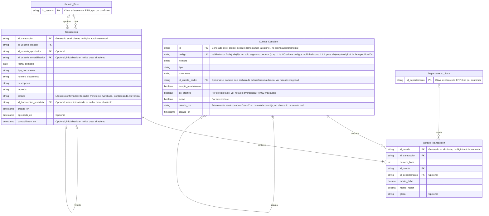

# Modelo de Datos — Módulo de Contabilidad y Finanzas

## Propósito y límites

Este modelo define las tablas que pertenecen al módulo financiero y muestra sus referencias a datos maestros del ERP. `Usuario_Base` y `Departamento_Base` son dependencias compartidas: el módulo las consulta y referencia por sus claves, pero **no las crea, duplica ni administra**. Los nombres y tipos concretos de esas claves deben alinearse con el contrato del ERP anfitrión antes de implementar las restricciones SQL.

El modelo de datos publicado para el módulo base del repositorio especifica `Entity` y `Document`, pero no define las tablas `Usuario_Base` ni `Departamento_Base`. Por tanto, las claves de integración de abajo son un contrato conceptual pendiente de confirmar con el ERP anfitrión, no una afirmación de que ya están implementadas en este repositorio. El MVP financiero no requiere modificar `Entity` ni `Document`; una futura conciliación con facturas u otros documentos deberá añadir una relación explícita y acordada.

> **Nota de sincronización (2026-11-26)**: este documento fue actualizado para reflejar los nombres de campo, tipos y reglas realmente implementados en `src/domain/*.js`, `src/services/*.js` y `src/storage.js`, no solo el diseño original. No existe una base de datos: toda persistencia ocurre en `localStorage` del navegador, por lo que los identificadores primarios son cadenas generadas en el cliente (por ejemplo `account-{timestamp}-{aleatorio}`), no claves `bigint` autoincrementales de un motor SQL. Las divergencias de comportamiento respecto al diseño original se marcan explícitamente en las secciones correspondientes.

## Diagrama Entidad-Relación

## Entidades del módulo

### Cuenta_Contable

Catálogo de cuentas de la empresa. `codigo` identifica de forma única una cuenta dentro de la instancia financiera (el campo real se llama `codigo`, no `codigo_cuenta`; igualmente `nombre`, no `nombre_cuenta`). `tipo` clasifica la cuenta como Activo, Pasivo, Patrimonio, Ingreso o Egreso; `naturaleza` identifica su saldo normal (Debe o Haber). `id_cuenta_padre` permite construir jerarquías, pero el validador de dominio (`accountValidator` en `src/domain/account.js`) solo rechaza la autorreferencia directa (`id_cuenta_padre === id`); no verifica ciclos indirectos ni que el padre esté activo — ver "Integridad del plan de cuentas" más abajo para dónde vive realmente esa protección. `es_efectivo` identifica las cuentas que representan efectivo o bancos para el Flujo de Caja (FR-033); por diseño no debería deducirse del nombre, código ni tipo, aunque el Panel General actualmente sí aplica una heurística adicional (ver nota siguiente).

### Designación de efectivo/bancos (FR-033) — divergencia confirmada

`Cuenta_Contable.es_efectivo` es un booleano obligatorio con valor por defecto `false`, establecido desde el plan de cuentas. `src/views/reportes.js` filtra el Flujo de Caja exclusivamente por `es_efectivo === true`, sin excepciones. **`src/views/dashboard.js`, en cambio, usa `es_efectivo === true` solo para egresos; para ingresos de caja también acepta cualquier cuenta con `tipo === 'Activo'` y `codigo` que empiece con `'1'` cuando `es_efectivo` no está marcado.** Con los datos sembrados (una sola cuenta con `es_efectivo: true`) esto no produce diferencias visibles, pero es una divergencia real frente al requisito de "no deducir del nombre, código ni tipo" (FR-033) y un riesgo concreto para SC-013 (0 discrepancias entre panel y reporte) en catálogos con más cuentas de tipo Activo. Ningún cambio de `es_efectivo` queda registrado en la bitácora de auditoría real hoy (ver "Reglas de auditoría y ciclo de vida").

### Transaccion

Encabezado de un asiento contable. Guarda la fecha contable, el origen documental declarado, su descripción, moneda, estado y trazabilidad. `id_usuario_creador`, `id_usuario_aprobador` e `id_usuario_contabilizador` apuntan al usuario compartido del ERP. El aprobador, el contabilizador y sus marcas de tiempo son nulos mientras no se apruebe o contabilice el asiento. El identificador de documento de origen es informativo en el MVP: no es una FK a `Document` hasta que se defina la integración con ese módulo.

Estados confirmados en `src/domain/entry.js` (`ENTRY_STATE`): `Borrador`, `Pendiente`, `Aprobada`, `Contabilizada` y `Revertida` — estos son los literales exactos usados en el código, no solo nombres propuestos. La transición a contabilizada requiere aprobación. Un asiento contabilizado no se edita ni elimina: se corrige mediante otro asiento de reversa. Existen, sin embargo, **dos implementaciones de servicio independientes** tanto para aprobar (`entry-service.approveEntry`, `approval-service.approveEntry`) como para revertir (`entry-service.reverseEntry`, `reverse-service.reverseEntry`); la vista real `transacciones.js` ejecuta la transición a través de `entry-service.js`, usando `approval-service.canApprove`/`isValidTransition` solo como verificación previa antes de invocar la acción, no como la función que efectivamente cambia el estado. Un asiento en `Borrador` sí puede eliminarse físicamente desde `transacciones.js` (no solo desactivarse), a diferencia de las cuentas.

### Detalle_Transaccion

Línea de imputación a una cuenta y, opcionalmente, a un departamento/centro de costo. Cada transacción contabilizable contiene al menos dos líneas. En cada línea se registra un importe Debe o Haber, no ambos. **Divergencia confirmada**: `src/utils/money.js` solo impide que un importe con más de 4 decimales se acepte o redondee en el momento de parsear la entrada (`parseAmount`); una vez parseado, las operaciones `add`/`subtract`/`multiply`/`divide` de ese mismo módulo, y la propia verificación de balance Debe=Haber en `domain/entry.js` y en `entry-service.saveEntry`, trabajan con números de punto flotante estándar de JavaScript (`Math.round(x * 10000) / 10000`), no con una representación entera escalada. El objetivo de no perder precisión en los importes capturados por el usuario se cumple; la aritmética interna no es "nunca punto flotante" como describe la decisión técnica original.

## Integración y compatibilidad con el ERP base

| Necesidad financiera | Estructura compartida | Regla de integración |
|---|---|---|
| Autoría y permisos | `Usuario_Base` | Guardar la clave existente del usuario en creador/aprobador; resolver roles mediante identidad/RBAC del ERP. No almacenar credenciales ni duplicar la tabla de usuarios. |
| Centros de costo | `Departamento_Base` | Referenciar su clave desde las líneas. El centro de costo es opcional por línea según política contable. No crear un segundo catálogo de departamentos. |
| Presupuestos departamentales | `Departamento_Base.presupuesto_asignado`, si existe en el ERP anfitrión | Consultar o actualizar el campo compartido según permisos. No mantener una copia financiera divergente. Su nombre y disponibilidad deben confirmarse porque el modelo base del repositorio no lo documenta. |
| Entidades y documentos base | `Entity` y `Document` | No se alteran para el MVP. Una referencia financiera futura requiere mapear la clave pública `entity_id` o el `id` correspondiente mediante un contrato explícito; no asumir que equivale a `id_usuario` o `id_departamento`. |

Antes de crear FKs físicas, se confirmarán los nombres, tipos, esquema y reglas de borrado de las claves compartidas con el ERP anfitrión. Si los módulos usan bases de datos o servicios separados, esas referencias serán validaciones de integración y no FKs SQL cross-database.

## Claves, restricciones e integridad

- `Cuenta_Contable.id`, `Transaccion.id_transaccion` y `Detalle_Transaccion.id_detalle` son cadenas generadas en el cliente (no hay base de datos ni claves autoincrementales); para cuentas el patrón confirmado es `account-{timestamp}-{aleatorio}`.
- `Cuenta_Contable.codigo` es obligatorio y único por instancia, validado por la expresión regular `/^\d+(\.\d+)?$/`. **Esto admite como máximo un segmento decimal (ej. `"1.1"`), no códigos jerárquicos multinivel como `"1.1.1"`** pese a que la especificación y versiones previas de este documento usaban ese ejemplo.
- `Cuenta_Contable.es_efectivo` es obligatorio, booleano y por defecto `false`. `reportes.js` filtra el flujo de caja estrictamente por `es_efectivo = true`; `dashboard.js` añade una heurística adicional por `tipo`/`codigo` para ingresos (ver divergencia FR-033 arriba) — la regla "ninguna heurística por nombre, código o tipo" NO se cumple hoy de forma uniforme en todas las vistas.
- `Transaccion.id_transaccion_revertida` es nulo para asientos normales; cuando se informa referencia al asiento original y es único, para impedir más de una reversa directa del mismo asiento. La reversa registra las mismas imputaciones con Debe y Haber intercambiados, aunque las dos implementaciones de reversa existentes (`entry-service.reverseEntry`, `reverse-service.reverseEntry`) difieren en el operador de comparación usado al decidir qué lado intercambiar (`>= 0` vs `> 0`).
- `Detalle_Transaccion` espera `monto_debe >= 0`, `monto_haber >= 0` y exactamente uno de los dos importes mayor que cero; esta regla se valida en `domain/entry.js` y se revalida en `entry-service.saveEntry`, pero **no** se aplica en `entry-service.addEntry`, una segunda función del mismo servicio que persiste un asiento sin ninguna validación y que no está restringida a uso en pruebas.
- Importes: límite de 4 decimales aplicado solo al parsear la entrada del usuario (`utils/money.js::parseAmount`); las operaciones aritméticas posteriores usan punto flotante estándar de JavaScript, no una escala decimal entera (ver divergencia en "Detalle_Transaccion" arriba). El MVP usa una moneda por asiento (formato de 3 letras validado contra el patrón ISO 4217, sin verificar contra una lista real de monedas) y no contempla conversión cambiaria automática.
- La suma de Debe debe ser exactamente igual a la suma de Haber para cada asiento que pase a `Contabilizada`. No existe base de datos ni trigger SQL: la regla se verifica en JavaScript, de forma redundante, tanto en `domain/entry.js::validateEntryLines` como en `entry-service.saveEntry` (ambas con aritmética de punto flotante); `validateEntryLines` además tiene un caso no cubierto: si todas las líneas son exclusivamente Debe (o exclusivamente Haber), su comprobación de balance no se dispara por sí sola, aunque la revalidación de `entry-service.saveEntry` sigue rechazando ese asiento por totales distintos.
- No se permite contabilizar (vía `saveEntry`) un asiento con menos de dos líneas, una cuenta inactiva/no imputable o una referencia a departamento inexistente; la referencia a un usuario inexistente no se verifica explícitamente en el código revisado.
- Un centro de costo nulo significa que la línea no está asignada a un departamento; las reglas de obligatoriedad pueden depender de cuenta o política.
- La moneda usa un patrón de 3 letras mayúsculas (`^[A-Z]{3}$`), sin validar contra la lista real ISO 4217. Fechas de emisión usan formato `YYYY-MM-DD`; no hay zona horaria explícita en las marcas de auditoría más allá del `Date.toISOString()` del navegador.
- **Borrado de cuentas referenciadas (FR-034) — comportamiento invertido confirmado**: `account-service.checkAccountIntegrity` bloquea el borrado solo si la cuenta está referenciada por un asiento en `Borrador`, `Pendiente` o `Aprobada`. Si la cuenta solo está referenciada por asientos `Contabilizada` o `Revertida`, el borrado **no se bloquea** por esa vía — el caso contrario a la intención de FR-034 de proteger la trazabilidad histórica. Además, `domain/account.js::deleteAccount` (invocado directamente por algunas rutas) solo verifica si la cuenta ya está inactiva; si está activa, permite el borrado sin comprobar ninguna referencia.
- **Ciclos jerárquicos**: `domain/account.js::accountValidator` solo rechaza la autorreferencia directa. La detección de ciclos indirectos y de recursión segura (`account-service.checkForCycle`, con conjunto de visitados) solo se invoca en el flujo de borrado, nunca al asignar un nuevo padre. La única protección que el usuario ve al crear/editar una cuenta vive en la propia vista `plan-cuentas.js` (`creaCicloJerarquico`), no en la capa de dominio ni de servicio.
- **Borrado de usuarios/departamentos referenciados (FR-021, FR-023)**: `domain/shared.js::canDeleteUser`/`canDeleteDepartment` solo impiden eliminar el último registro restante de cada catálogo; no verifican si el usuario o departamento está referenciado por ninguna línea de asiento.

## Reglas de auditoría y ciclo de vida

1. Toda creación de **asiento** registra usuario y `creado_en`; aprobaciones registran usuario aprobador y `aprobado_en`; contabilización registra `id_usuario_contabilizador` y `contabilizado_en`. **Esto no aplica a cuentas**: ningún evento de creación, edición, desactivación o reactivación de una `Cuenta_Contable` llega a la bitácora global (`audit-service`) — ni `domain/account.js` ni `account-service.js` la invocan. `plan-cuentas.js` escribe en su lugar a una clave de `localStorage` separada y de solo escritura (`accountAuditLogs`, capada a 50 registros) que ninguna vista vuelve a leer, por lo que la vista de Auditoría (`auditoria.js`) solo muestra eventos de asientos.
2. Solo borradores pueden corregirse; un borrador también puede eliminarse físicamente desde `transacciones.js` (no solo desactivarse). Los asientos contabilizados son inmutables y no se eliminan físicamente.
3. Una reversa crea un nuevo asiento enlazado con `id_transaccion_revertida`, conserva la referencia y descripción del motivo y revierte cada par Debe/Haber. Ver la nota de las dos implementaciones de reversa arriba.
4. La baja de una cuenta con movimientos debería resolverse desactivándola en vez de borrarla, pero el estado actual del chequeo de integridad (ver arriba) no cubre el caso de asientos ya `Contabilizada`/`Revertida`; los usuarios/departamentos referenciados tampoco están protegidos contra el borrado a nivel de dominio.
5. El control RBAC (`auth-service.js`: roles `ADMIN`/`CONTADOR`/`USER`) se aplica en código de aplicación antes de invocar las acciones de aprobación/contabilización/reversa (por ejemplo en `transacciones.js`), no solo ocultando controles de interfaz; sin embargo, las funciones de servicio que ejecutan la transición (`entry-service.approveEntry`, `entry-service.reverseEntry`) no reverifican el permiso por sí mismas, por lo que la protección depende de que el llamador ya haya verificado el permiso.

## Consultas que habilita el modelo

- Ingresos y egresos contabilizados por período y cuenta.
- Resultado neto del período a partir de las cuentas de Ingreso y Egreso.
- Flujo de caja básico a partir de las cuentas con `es_efectivo = true` y asientos `Contabilizada`, usando la misma designación en el panel y en el reporte.
- Gastos por departamento/centro de costo y comparación con el presupuesto compartido disponible.
- Historial de creación, aprobación, contabilización y reversa por usuario y fecha.

## Fuera del MVP / decisiones pendientes

- Conciliación bancaria automática, multimoneda y tipos de cambio.
- Cuentas por cobrar/pagar enlazadas automáticamente a `Document`, impuestos configurables y períodos de cierre bloqueados.
- Estándar contable y país (por ejemplo, estructura del plan de cuentas e impuestos aplicables).
- Motor de aprobación, umbral de alto valor, política de centros de costo obligatorios y autorización concreta por rol.
- Motor SQL y compatibilidad exacta de tipos/DDL; el modelo especifica semántica relacional independiente del proveedor.