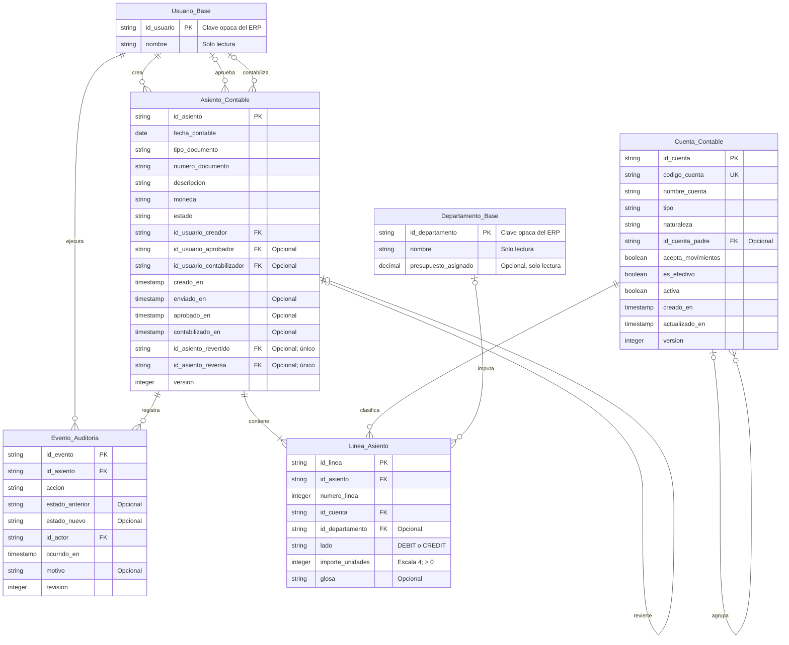

# Modelo de Datos: Módulo de Contabilidad y Finanzas

**Feature**: `002-contabilidad-finanzas` | **Date**: 2026-11-03 | **Spec**: [spec.md](spec.md)

## Propósito y límites

Este modelo define las entidades del módulo financiero y sus referencias a los catálogos compartidos del ERP. `Usuario_Base` y `Departamento_Base` son dependencias de solo referencia: el módulo financiero las consulta por su clave, pero no las crea, duplica ni administra. Los nombres y tipos concretos de esas claves los define el adaptador del ERP anfitrión; aquí se modelan como cadenas opacas.

El modelo es lógico y agnóstico del motor de persistencia. La implementación de esta versión lo materializa en `localStorage` con el contrato descrito en [contracts/finance-storage.md](contracts/finance-storage.md). Una futura implementación con backend puede reutilizar las mismas entidades y reglas.

## Diagrama Entidad-Relación



## Entidades

### Cuenta_Contable

Representa una cuenta del plan de cuentas de la empresa.

| Campo | Tipo lógico | Obligatorio | Reglas |
|---|---|---|---|
| `id_cuenta` | Cadena única | Sí | Generado por el sistema; inmutable |
| `codigo_cuenta` | Texto | Sí | Único tras recortar espacios; se conserva como texto (`"1.1.1"`) |
| `nombre_cuenta` | Texto | Sí | No vacío |
| `tipo` | Enumeración | Sí | `ACTIVO`, `PASIVO`, `PATRIMONIO`, `INGRESO`, `EGRESO` |
| `naturaleza` | Enumeración | Sí | `DEBIT` o `CREDIT` |
| `id_cuenta_padre` | Referencia | No | Debe existir, estar activa y no generar ciclos |
| `acepta_movimientos` | Booleano | Sí | Solo las cuentas que aceptan movimientos pueden usarse en líneas |
| `es_efectivo` | Booleano | Sí | Identifica cuentas de caja/bancos para el flujo de caja |
| `activa` | Booleano | Sí | Las cuentas inactivas no pueden usarse en nuevas líneas |
| `creado_en` | Fecha/hora | Sí | Generado por el sistema |
| `actualizado_en` | Fecha/hora | Sí | Se actualiza en cada cambio |
| `version` | Entero | Sí | Control de concurrencia optimista |

**Reglas de validación**:

- El código se recorta y se compara de forma exacta; no se interpreta como número.
- No se permite `id_cuenta_padre === id_cuenta`.
- No se permiten ciclos en la jerarquía; se recorre la cadena de ancestros con un conjunto de visitados.
- El padre debe existir y estar activo.
- Una cuenta con hijos o con líneas asociadas no se elimina; se desactiva.
- Desactivar una cuenta padre con descendientes activos se bloquea con un mensaje claro.
- Los saldos no se almacenan en la cuenta; se derivan de las líneas de asientos contabilizados.

### Asiento_Contable

Representa el encabezado de una operación contable.

| Campo | Tipo lógico | Obligatorio | Reglas |
|---|---|---|---|
| `id_asiento` | Cadena única | Sí | Generado por el sistema; inmutable |
| `fecha_contable` | Fecha (`YYYY-MM-DD`) | Sí | Fecha válida; se usa para períodos y filtros |
| `tipo_documento` | Texto | Sí | No vacío |
| `numero_documento` | Texto | Sí | No vacío |
| `descripcion` | Texto | Sí | No vacío |
| `moneda` | Texto | Sí | Código de tres letras; una sola moneda por asiento |
| `estado` | Enumeración | Sí | `Borrador`, `Pendiente`, `Aprobada`, `Contabilizada`, `Revertida` |
| `id_usuario_creador` | Referencia | Sí | Debe existir en el catálogo compartido |
| `id_usuario_aprobador` | Referencia | No | Obligatorio al aprobar; debe existir |
| `id_usuario_contabilizador` | Referencia | No | Obligatorio al contabilizar; debe existir |
| `creado_en` | Fecha/hora | Sí | Generado por el sistema |
| `enviado_en` | Fecha/hora | No | Se registra al pasar a `Pendiente` |
| `aprobado_en` | Fecha/hora | No | Se registra al pasar a `Aprobada` |
| `contabilizado_en` | Fecha/hora | No | Se registra al pasar a `Contabilizada` |
| `id_asiento_revertido` | Referencia | No | Asiento original que este asiento revierte; único |
| `id_asiento_reversa` | Referencia | No | Asiento de reversa que corrige a este; único |
| `version` | Entero | Sí | Control de concurrencia optimista |

**Reglas de validación**:

- Debe tener al menos dos líneas y al menos una línea de Debe y una de Haber.
- La suma de importes de líneas `DEBIT` debe ser exactamente igual a la suma de líneas `CREDIT`.
- Todas las líneas deben usar cuentas existentes, activas y que acepten movimientos.
- Todas las líneas deben usar la misma moneda del encabezado; no hay conversión cambiaria.
- Un asiento `Contabilizada` o `Revertida` no se edita ni se elimina.
- Un asiento solo puede revertirse si está `Contabilizada` y no tiene ya una reversa directa.
- La reversa copia las líneas con los lados invertidos y conserva cuenta, centro de costo, importe y glosa.
- Un asiento de reversa no puede ser revertido directamente; se corrige con otra operación según la política contable.

### Linea_Asiento

Representa una imputación individual dentro de un asiento.

| Campo | Tipo lógico | Obligatorio | Reglas |
|---|---|---|---|
| `id_linea` | Cadena única | Sí | Generado por el sistema |
| `id_asiento` | Referencia | Sí | Debe existir |
| `numero_linea` | Entero | Sí | Único dentro del asiento; secuencial desde 1 |
| `id_cuenta` | Referencia | Sí | Cuenta existente, activa y que acepta movimientos |
| `id_departamento` | Referencia | No | Debe existir en el catálogo compartido cuando se informa |
| `lado` | Enumeración | Sí | `DEBIT` o `CREDIT`; exactamente uno por línea |
| `importe_unidades` | Entero | Sí | Mayor que cero; escala 4; entero seguro |
| `glosa` | Texto | No | Descripción de la línea |

**Reglas de validación**:

- Una línea no puede tener simultáneamente Debe y Haber; el lado es único.
- El importe se expresa en unidades de 1/10.000 y debe ser un entero positivo.
- Se rechazan importes con más de cuatro decimales en la entrada; no se redondean.
- La combinación (`id_asiento`, `numero_linea`) es única.
- El centro de costo es opcional; su obligatoriedad puede depender de la cuenta o de la política contable.
- Una línea de un asiento contabilizado es inmutable.

### Evento_Auditoria

Registra cada cambio relevante de un asiento para mantener la trazabilidad.

| Campo | Tipo lógico | Obligatorio | Reglas |
|---|---|---|---|
| `id_evento` | Cadena única | Sí | Generado por el sistema |
| `id_asiento` | Referencia | Sí | Asiento afectado |
| `accion` | Enumeración | Sí | `CREAR`, `EDITAR`, `ENVIAR`, `DEVOLVER`, `APROBAR`, `CONTABILIZAR`, `REVERTIR` |
| `estado_anterior` | Enumeración | No | Nulo en la creación |
| `estado_nuevo` | Enumeración | No | Estado resultante cuando aplica |
| `id_actor` | Referencia | Sí | Usuario que ejecuta la acción |
| `ocurrido_en` | Fecha/hora | Sí | Marca temporal con zona horaria |
| `motivo` | Texto | No | Obligatorio para devolución y reversa |
| `revision` | Entero | Sí | Versión del asiento al momento del evento |

Los eventos son de solo adición; no se editan ni se eliminan.

### Usuario_Base (dependencia compartida)

Identidad existente del ERP. El módulo financiero solo usa `id_usuario` para creador, aprobador, contabilizador y actor de auditoría. Los permisos se resuelven mediante el adaptador de identidad. No se almacenan credenciales ni se duplica el catálogo.

### Departamento_Base (dependencia compartida)

Centro de costo existente del ERP. El módulo financiero referencia `id_departamento` desde las líneas. No se crea ni se duplica el catálogo. El presupuesto departamental, si existe, es de solo lectura y queda fuera del alcance de esta versión.

## Transiciones de estado

| Estado actual | Acción | Estado nuevo | Permiso requerido | Efectos |
|---|---|---|---|---|
| `Borrador` | Enviar a revisión | `Pendiente` | `finance.entry.submit` | Registra `enviado_en` y evento |
| `Pendiente` | Devolver | `Borrador` | `finance.entry.approve` | Registra motivo y evento |
| `Pendiente` | Aprobar | `Aprobada` | `finance.entry.approve` | Registra aprobador, `aprobado_en` y evento |
| `Aprobada` | Contabilizar | `Contabilizada` | `finance.entry.post` | Registra contabilizador, `contabilizado_en` y evento; congela el asiento |
| `Contabilizada` | Revertir | `Revertida` | `finance.entry.reverse` | Crea asiento de reversa, enlaza ambos y registra evento |

Cualquier otra transición se rechaza. No se permite pasar de `Borrador` directamente a `Contabilizada`, ni de `Aprobada` a `Revertida`.

## Invariantes del dominio

1. La suma de Debe es exactamente igual a la suma de Haber en todo asiento que se guarda o contabiliza.
2. Todo asiento tiene al menos dos líneas y al menos un cargo y un abono.
3. Cada línea tiene exactamente un lado y un importe positivo con escala máxima de cuatro decimales.
4. Ningún asiento `Contabilizada` o `Revertida` puede modificarse o eliminarse.
5. Una reversa solo se crea desde un asiento `Contabilizada` sin reversa previa; los enlaces son bidireccionales y únicos.
6. Todo cambio de estado genera un evento de auditoría con actor y fecha.
7. Los reportes incluyen asientos con `contabilizado_en` no nulo, es decir, `Contabilizada` y `Revertida`, para que las reversas neten a cero.
8. Los saldos y métricas se derivan de las líneas; no se almacenan saldos acumulados.
9. Las cuentas con movimientos o hijos no se eliminan; se desactivan.
10. Las referencias a usuarios y departamentos deben existir en el catálogo compartido al guardar o ejecutar una transición.

## Representación monetaria

- `importe_unidades` es un entero con escala 4: `12345` representa `1.2345`.
- El rango seguro de `Number` permite importes muy superiores a los necesarios para esta versión.
- La entrada de usuario se analiza como texto y se valida contra un formato que admita hasta cuatro decimales.
- La presentación usa `Intl.NumberFormat` con la configuración regional española; la aritmética nunca usa el valor formateado.
- No se permiten importes negativos; el lado de la línea determina si suma al Debe o al Haber.
- No se redondean importes de línea; se rechaza el exceso de precisión.

## Persistencia lógica

La forma persistida agrupa las colecciones bajo una raíz versionada:

```text
erp:finance:state
├── schemaVersion: 1
├── stateRevision: entero
├── savedAt: ISO-8601
└── data
    ├── accounts: Cuenta_Contable[]
    ├── entries: Asiento_Contable[] (con lines: Linea_Asiento[])
    ├── audit: Evento_Auditoria[]
    └── settings: configuración local (moneda por defecto, período)
```

Las líneas se almacenan anidadas dentro de su asiento para garantizar que una escritura no deje líneas huérfanas. Los índices de búsqueda (por fecha, estado, cuenta, departamento y texto) se derivan al leer, no se persisten.

## Consultas que habilita el modelo

- Ingresos y egresos contabilizados por período y cuenta.
- Resultado neto del período a partir de cuentas de Ingreso y Egreso.
- Flujo de caja a partir de cuentas marcadas como `es_efectivo`.
- Gastos por departamento/centro de costo.
- Historial de creación, envío, aprobación, contabilización y reversa por usuario y fecha.
- Búsqueda combinada por rango de fechas, cuenta, departamento, estado y texto libre.
- Saldos consolidados por cuenta padre a partir de las líneas contabilizadas.

## Fuera del modelo / decisiones pendientes

- Conciliación bancaria automática, multimoneda y tipos de cambio.
- Cuentas por cobrar/pagar enlazadas automáticamente a documentos de facturación.
- Impuestos configurables y períodos de cierre bloqueados.
- Estándar contable y reglas fiscales específicas de un país.
- Motor de aprobación por umbral de alto valor y política de centros de costo obligatorios.
- Sincronización con un backend o ERP central; esta versión es local al navegador.
- Esquema SQL concreto y tipos de base de datos; el modelo es lógico y portable.
